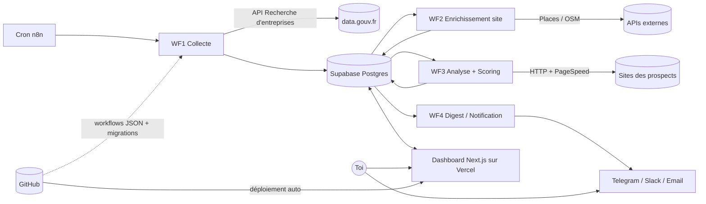

# Prospection IA automatisée : cahier des charges, architecture et conception

**Version :** 1.0 · **Date :** 15 octobre 2026
**Stack :** n8n · Supabase · Vercel · Git/GitHub · Freebuff (aide au code)
**Contrainte principale :** coût total = 0 € (ou quasi)

---

## 1. Contexte et objectifs

### 1.1 Contexte
La prospection manuelle est lente et les listes achetées sont saturées. L'objectif est de construire un « agent commercial » automatisé qui détecte des entreprises dont le site web est faible ou obsolète, les note, puis livre les meilleurs leads pour proposer des services de création ou refonte de site.

### 1.2 Objectifs
| # | Objectif | Indicateur |
|---|---|---|
| O1 | Automatiser la collecte d'entreprises ciblées | ≥ 500 entreprises/semaine collectées |
| O2 | Qualifier chaque lead par un score 0-10 | 100 % des leads avec site analysés |
| O3 | Livrer uniquement les leads pertinents | Score ≥ seuil configurable (défaut 7) |
| O4 | Suivre le pipeline commercial | Statuts à jour dans le dashboard |
| O5 | Rester dans une enveloppe gratuite | 0 € de coût récurrent obligatoire |

### 1.3 Périmètre
**Inclus :** ciblage, collecte, recherche du site web, analyse technique du site, scoring, notification, dashboard de suivi, export CSV.

**Exclus (v1) :** envoi automatique d'emails de prospection, CRM complet, multi-utilisateurs, facturation.

> L'envoi d'emails est volontairement exclu de la v1. Cela limite les risques RGPD et de réputation du domaine. Il pourra venir en v2, avec validation humaine.

---

## 2. Utilisateurs et rôles

| Rôle | Description | Droits |
|---|---|---|
| **Propriétaire** (toi) | Seul utilisateur en v1 | Tout : configuration, leads, workflows |
| **Système (n8n)** | Automate | Écriture en base via clé service |

---

## 3. Exigences fonctionnelles

### 3.1 Ciblage (RF-01 à RF-03)
- **RF-01** : définir des campagnes avec : codes NAF, départements/villes, tranche d'effectif, seuil de score.
- **RF-02** : activer/désactiver une campagne.
- **RF-03** : planifier la fréquence d'exécution (cron) par campagne.

### 3.2 Collecte (RF-04 à RF-07)
- **RF-04** : interroger l'API publique « Recherche d'entreprises » (data.gouv.fr) avec pagination.
- **RF-05** : dédoublonner par SIREN (upsert).
- **RF-06** : ne garder que les entreprises actives (état administratif « A »).
- **RF-07** : retrouver l'URL du site web et l'email professionnel (Google Places, OpenStreetMap, ou saisie manuelle).

### 3.3 Qualification (RF-08 à RF-11)
- **RF-08** : télécharger la page d'accueil du site et en extraire des indicateurs techniques.
- **RF-09** : appeler l'API PageSpeed Insights (mobile).
- **RF-10** : calculer un score 0-10 et stocker les raisons détaillées (JSON).
- **RF-11** : réanalyser un lead après N jours (configurable).

### 3.4 Livraison (RF-12 à RF-14)
- **RF-12** : notifier (Telegram, Slack ou email) les nouveaux leads dépassant le seuil, en digest quotidien.
- **RF-13** : la notification contient nom, ville, site, score, raisons et lien vers la fiche.
- **RF-14** : exporter les leads filtrés en CSV.

### 3.5 Dashboard (RF-15 à RF-19)
- **RF-15** : authentification (Supabase Auth, 1 utilisateur).
- **RF-16** : liste des leads avec filtres (score, NAF, ville, statut) et tri.
- **RF-17** : fiche lead : infos, raisons du score, historique, notes.
- **RF-18** : changement de statut : `nouveau → à_contacter → contacté → répondu → gagné/perdu/ignoré`.
- **RF-19** : page d'état des exécutions (dernier run, erreurs, nombre de leads).

---

## 4. Exigences non fonctionnelles

| Catégorie | Exigence |
|---|---|
| **Coût** | Uniquement des offres gratuites ; alerte si un quota approche de 80 % |
| **Fiabilité** | Reprise automatique (retry ×3) sur erreur réseau ; un lead en erreur ne bloque pas le lot |
| **Performance** | Dashboard < 2 s pour 10 000 leads (index + pagination côté serveur) |
| **Politesse du crawl** | Max 1 requête/s par domaine, timeout 10 s, respect de `robots.txt`, User-Agent identifiable |
| **Sécurité** | Secrets hors Git, RLS activée sur toutes les tables, clé `service_role` jamais exposée au front |
| **Maintenabilité** | Tout versionné dans Git (SQL, workflows n8n exportés, dashboard) |
| **Observabilité** | Table `runs` + notification d'échec de workflow |
| **RGPD** | Voir section 9 |

---

## 5. Contraintes et hypothèses

| Sujet | Détail |
|---|---|
| Supabase gratuit | 500 Mo de base ; projet mis en pause après ~1 semaine d'inactivité (un cron régulier évite la pause) |
| Vercel Hobby | Réservé à l'usage non commercial selon les conditions d'utilisation. Voir risque R4 |
| n8n | Édition communautaire auto-hébergée (gratuite pour usage interne) |
| Hébergement n8n | Local au début. Ensuite VPS gratuit (Oracle Free Tier) ou petit VPS payant |
| API Recherche d'entreprises | Gratuite, sans clé, limitée en débit : à respecter |
| Google Places | Crédit gratuit mensuel mais carte bancaire requise : optionnel |
| Freebuff | Outil d'aide au code uniquement, hors du chemin d'exécution de l'agent |

---

## 6. Architecture

### 6.1 Vue d'ensemble



### 6.2 Composants

| Composant | Techno | Responsabilité |
|---|---|---|
| Orchestrateur | n8n (Docker) | Exécute les 5 workflows, gère retries et planification |
| Base de données | Supabase Postgres | Source de vérité, RLS, Auth |
| Dashboard | Next.js (App Router) + TypeScript + Tailwind | Consultation, filtres, suivi du pipeline |
| Hébergement front | Vercel | Déploiement continu depuis GitHub |
| Code source | GitHub | Dashboard, migrations SQL, workflows exportés |
| Aide au code | Freebuff | Génération du code du dashboard et des scripts |

### 6.3 Flux de données (résumé)
1. WF1 lit les campagnes actives, interroge l'API publique et fait un upsert dans `companies`.
2. WF2 prend les entreprises sans site connu et cherche l'URL et l'email.
3. WF3 analyse les sites, calcule le score et écrit dans `analyses` et `leads`.
4. WF4 construit le digest des leads au-dessus du seuil non encore notifiés.
5. Le dashboard lit Supabase (clé `anon` + session) et met à jour statuts et notes.

### 6.4 Environnements
| Env | n8n | Supabase | Dashboard |
|---|---|---|---|
| Dev | Docker local | Projet « dev » (ou Supabase CLI local) | `localhost:3000` |
| Prod | VPS | Projet « prod » | Vercel (branche `main`) |

---

## 7. Conception détaillée

### 7.1 Modèle de données (PostgreSQL / Supabase)

```sql
-- Campagnes de ciblage
create table campaigns (
  id uuid primary key default gen_random_uuid(),
  name text not null,
  naf_codes text[] not null,
  departements text[] default '{}',
  villes text[] default '{}',
  effectif_min int,
  score_threshold int not null default 7,
  cron text default '0 6 * * *',
  active boolean not null default true,
  created_at timestamptz default now()
);

-- Entreprises (source : registre public)
create table companies (
  siren text primary key,
  name text not null,
  naf text,
  address text,
  city text,
  postal_code text,
  effectif text,
  website text,
  email text,
  phone text,
  website_source text,            -- places | osm | manual
  campaign_id uuid references campaigns(id),
  raw jsonb,
  created_at timestamptz default now(),
  updated_at timestamptz default now()
);

-- Analyses techniques de site (historisées)
create table analyses (
  id uuid primary key default gen_random_uuid(),
  siren text references companies(siren) on delete cascade,
  analyzed_at timestamptz default now(),
  http_status int,
  https boolean,
  has_viewport boolean,
  copyright_year int,
  tech_hints text[],              -- ex: wordpress, wix, jquery
  psi_mobile_score int,           -- 0-100
  error text
);

-- Leads (vue métier du suivi commercial)
create type lead_status as enum
  ('nouveau','a_contacter','contacte','repondu','gagne','perdu','ignore');

create table leads (
  siren text primary key references companies(siren) on delete cascade,
  score int not null check (score between 0 and 10),
  reasons jsonb not null default '[]',
  status lead_status not null default 'nouveau',
  notified_at timestamptz,
  contacted_at timestamptz,
  notes text,
  updated_at timestamptz default now()
);

-- Journal d'exécution
create table runs (
  id uuid primary key default gen_random_uuid(),
  workflow text not null,
  started_at timestamptz default now(),
  finished_at timestamptz,
  status text,                    -- success | partial | error
  items_processed int default 0,
  error text
);

-- Index
create index on leads (score desc, status);
create index on companies (naf);
create index on companies (city);
create index on analyses (siren, analyzed_at desc);
```

**Sécurité (RLS) :** activer RLS sur toutes les tables. Politique : lecture/écriture réservées à l'utilisateur authentifié (ton `auth.uid()`). n8n utilise la clé `service_role`, qui contourne RLS et reste stockée uniquement dans les credentials n8n.

### 7.2 Workflows n8n

| Workflow | Déclencheur | Étapes principales |
|---|---|---|
| **WF1 Collecte** | Cron | Lire campagnes actives → boucle NAF × département → HTTP (pagination) → filtrer actifs → upsert `companies` → log `runs` |
| **WF2 Enrichissement** | Cron (après WF1) | Sélectionner `companies` sans `website` → Places/OSM → mise à jour → marquer « introuvable » si aucun résultat |
| **WF3 Analyse + Scoring** | Cron | Sélectionner entreprises avec site non analysées (ou > N jours) → HTTP GET → extraire indicateurs → PSI → calculer score → insérer `analyses` + upsert `leads` |
| **WF4 Digest** | Cron quotidien | Leads `score ≥ seuil` et `notified_at is null` → message groupé → envoi → mise à jour `notified_at` |
| **WF5 Erreurs** | Error Trigger | Capturer l'échec d'un workflow → notification → log `runs` |

**Bonnes pratiques n8n :** nœud *Split in Batches* (lots de 10-25), *Wait* entre requêtes pour respecter les débits, *Retry on Fail* ×3 avec délai croissant, `Continue on Fail` sur l'analyse de site pour ne pas bloquer le lot.

### 7.3 Grille de scoring (0-10, plafonnée)

| Critère | Points | Détection |
|---|---|---|
| Aucun site web trouvé | +4 | `website is null` après WF2 |
| Site inaccessible (4xx/5xx/timeout) | +4 | `http_status` |
| Pas de HTTPS | +2 | URL / redirection |
| Pas de balise `viewport` (non responsive) | +3 | HTML |
| Score PageSpeed mobile < 50 | +2 (< 30 : +3) | API PSI |
| Copyright / année > 3 ans | +1 | Regex pied de page |
| Technologie datée (jQuery ancien, Flash, tables) | +1 | Indices dans le HTML |

Le score est plafonné à 10. Chaque critère déclenché alimente `reasons` (ex. `["Pas de version mobile","Site non sécurisé (HTTP)"]`), ce qui sert directement à personnaliser l'approche commerciale.

> Les pondérations sont un point de départ. Elles se règlent après avoir observé 50-100 résultats réels.

### 7.4 Dashboard (Next.js)

**Pages**
| Route | Contenu |
|---|---|
| `/login` | Authentification Supabase |
| `/` | KPIs : leads du jour, score moyen, répartition par statut |
| `/leads` | Tableau filtrable (score, NAF, ville, statut), tri, pagination serveur, export CSV |
| `/leads/[siren]` | Fiche détaillée, raisons du score, historique d'analyses, notes, changement de statut |
| `/campaigns` | CRUD des campagnes |
| `/runs` | Journal des exécutions et erreurs |

**Stack front :** Next.js (App Router), TypeScript, Tailwind, `@supabase/ssr`, TanStack Table.

### 7.5 Structure du dépôt Git

```
prospection-ia/
├── apps/
│   └── dashboard/               # Next.js
├── supabase/
│   ├── migrations/              # fichiers SQL versionnés
│   └── seed.sql
├── n8n/
│   ├── workflows/               # exports JSON (wf1..wf5)
│   └── docker-compose.yml
├── docs/
│   └── cahier-des-charges.md
├── .env.example                 # jamais de vrais secrets
└── README.md
```

**Workflow Git :** branche `main` protégée, branches `feat/*`, commits conventionnels, déploiement Vercel automatique sur `main`, export des workflows n8n à chaque modification significative.

### 7.6 Secrets et configuration

| Variable | Où | Remarque |
|---|---|---|
| `SUPABASE_URL`, `SUPABASE_ANON_KEY` | Dashboard (Vercel) | Publique par conception, protégée par RLS |
| `SUPABASE_SERVICE_ROLE_KEY` | n8n credentials uniquement | **Jamais** dans le dashboard ni dans Git |
| `PSI_API_KEY` | n8n | Clé Google (gratuite) |
| `GOOGLE_PLACES_KEY` | n8n | Optionnel |
| `TELEGRAM_BOT_TOKEN`, `CHAT_ID` | n8n | Notification |

---

## 8. Plan de réalisation

| Sprint | Contenu | Livrable |
|---|---|---|
| **S0** | Dépôt Git, projets Supabase, n8n en Docker, `.env.example` | Environnement prêt |
| **S1** | Migrations SQL + RLS, WF1 Collecte | Entreprises en base |
| **S2** | WF2 Enrichissement (recherche du site) | Sites et emails associés |
| **S3** | WF3 Analyse + scoring | Leads notés |
| **S4** | WF4 Digest + WF5 Erreurs | Notifications fiables |
| **S5** | Dashboard : login, liste, fiche, statuts | Suivi du pipeline |
| **S6** | Campagnes, runs, export CSV, réglage du scoring | v1 utilisable |
| **S7** | Déploiement prod (VPS + Vercel), monitoring | Mise en production |

---

## 9. Conformité RGPD et déontologie

- **Base légale :** intérêt légitime pour la prospection B2B.
- **Données :** uniquement des données d'entreprises et d'adresses professionnelles (éviter les emails nominatifs personnels).
- **Information et opposition :** tout futur message contient l'identité de l'expéditeur, l'origine des données et un lien de désinscription fonctionnel.
- **Liste d'opposition :** table `blocklist` (emails/SIREN) consultée avant toute notification ou contact.
- **Durée de conservation :** suppression ou anonymisation des leads inactifs après 12 mois.
- **Transparence du crawl :** respect de `robots.txt`, débit limité, User-Agent identifiable.
- **À vérifier :** les règles de la CNIL et celles du pays du prospect selon ta situation (basé à Madagascar, cibles en France). Ceci n'est pas un avis juridique.

---

## 10. Risques et parades

| # | Risque | Impact | Parade |
|---|---|---|---|
| R1 | Registre public sans URL de site | Moins de leads qualifiables | Places/OSM, saisie manuelle, viser d'abord les « sans site » |
| R2 | Quotas/limites d'API dépassés | Collecte interrompue | Lots réduits, pauses, retry, suivi dans `runs` |
| R3 | Supabase gratuit mis en pause | Base indisponible | Cron régulier (WF1) qui maintient l'activité |
| R4 | Vercel Hobby non commercial | Conformité aux CGU | Passer sur Cloudflare Pages / Netlify, ou plan payant si usage commercial avéré |
| R5 | Faux positifs (site bien conçu noté bas) | Temps perdu | Calibrage des pondérations, vérification manuelle avant contact |
| R6 | Blocage anti-bot par certains sites | Analyses en erreur | `Continue on Fail`, statut « non analysable », ne pas contourner |
| R7 | n8n arrêté (machine locale éteinte) | Pas d'automatisation 24/7 | VPS dès la phase S7 |
| R8 | Réputation du domaine d'envoi (v2) | Emails en spam | Domaine dédié, SPF/DKIM/DMARC, petits volumes, validation humaine |

---

## 11. Critères d'acceptation (v1)

- [ ] Une campagne configurée déclenche WF1 et alimente `companies` sans doublon.
- [ ] ≥ 80 % des entreprises avec site reçoivent une analyse sans erreur.
- [ ] Chaque lead a un score 0-10 et au moins une raison lisible.
- [ ] Un digest quotidien arrive avec uniquement les leads ≥ seuil, sans doublon.
- [ ] Le dashboard permet de filtrer, ouvrir une fiche et changer un statut.
- [ ] Aucun secret n'est présent dans le dépôt Git.
- [ ] RLS activée : un accès anonyme ne lit aucune donnée.
- [ ] Le coût récurrent est de 0 € sur l'environnement de test.

---

## 12. Évolutions possibles (v2)

- Rédaction assistée de messages personnalisés (LLM) avec validation humaine.
- Envoi d'emails via un outil dédié, avec suivi des ouvertures et réponses.
- Extension à d'autres pays/registres.
- Scoring enrichi (SEO de base, accessibilité, Core Web Vitals détaillés).
- Intégration d'un CRM externe.
