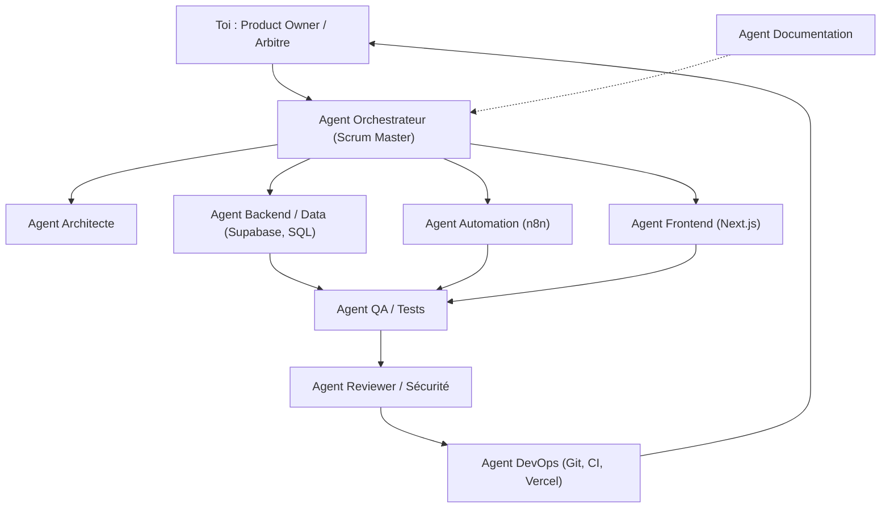
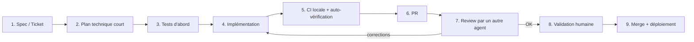

# Équipe d'agents développeurs : structure et méthode de travail

**Objectif :** livrer vite et proprement avec des agents IA (Freebuff, ou tout autre outil), organisés comme une vraie équipe Scrum.
**Principe :** toi = Product Owner + arbitre final. Les agents exécutent, testent et relisent. Rien n'est fusionné sans CI verte et ta validation.

> Dans la pratique, un « agent » = une session d'outil de code avec un **prompt de rôle**, un **périmètre précis** et un **livrable défini**. L'intérêt : séparer les responsabilités et relire avec un contexte neuf (un agent qui relit son propre code voit mal ses erreurs).

---

## 1. Structure de l'équipe



| Rôle | Responsabilité | Entrée | Sortie | Ne doit PAS |
|---|---|---|---|---|
| **Product Owner (toi)** | Vision, priorités, validation finale | Besoins | Backlog priorisé, décisions | |
| **Orchestrateur (Scrum Master)** | Découper en tickets, planifier le sprint, suivre l'avancement, lever les blocages | Backlog | Sprint backlog, rapport quotidien | Écrire du code métier |
| **Architecte** | Décisions techniques, modèle de données, contrats d'interface | Ticket + cahier des charges | Plan technique court, ADR | Implémenter |
| **Backend / Data** | Migrations SQL, RLS, fonctions, requêtes | Plan technique | Migrations + tests SQL | Toucher au front ou aux workflows |
| **Automation** | Workflows n8n (JSON), retries, gestion d'erreurs | Plan technique | Workflows exportés + doc | Modifier le schéma sans ticket |
| **Frontend** | Pages, composants, appels Supabase | Maquette/ticket | Code + tests composants | Modifier la base |
| **QA / Tests** | Écrire et lancer les tests, vérifier les critères d'acceptation | Ticket + code | Rapport de tests, bugs | Corriger le code lui-même |
| **Reviewer / Sécurité** | Relecture de PR : qualité, secrets, RLS, injections, RGPD | PR | Commentaires, approbation | Merger |
| **DevOps** | CI GitHub Actions, déploiements, variables d'environnement | Branche validée | Pipeline vert, déploiement | Contourner la CI |
| **Documentation** | README, changelog, ADR, docs d'exploitation | Tickets terminés | Docs à jour | |

### Version allégée (recommandée pour démarrer seul)
Quatre « chapeaux » suffisent : **Architecte → Développeur → QA/Reviewer → DevOps**. Tu ajoutes les rôles spécialisés quand un goulot apparaît.

---

## 2. Méthode : Scrum adapté (sprints courts, solo + agents)

### 2.1 Cadre
| Élément | Choix |
|---|---|
| Durée de sprint | **1 semaine** (retour rapide) |
| Taille du sprint backlog | 5 à 8 tickets, chacun terminable en ≤ 1/2 journée |
| Tableau | GitHub Projects (gratuit) : `Backlog → Prêt → En cours → Review → Fait` |
| Limite WIP | **Max 2 tickets « En cours »** (3 agents en parallèle maximum) |
| Branches | Trunk-based : branches courtes `feat/xxx`, vie < 1 jour, PR petites (< 300 lignes) |
| Intégration | CI obligatoire (lint, types, tests) avant merge |

### 2.2 Rituels (courts)
| Rituel | Durée | Contenu | Qui |
|---|---|---|---|
| **Sprint Planning** | 30 min, lundi | Choisir les tickets, vérifier la *Definition of Ready* | Toi + Orchestrateur |
| **Daily asynchrone** | 5 min | L'orchestrateur résume : fait / prévu / bloqué (fichier `docs/daily.md`) | Orchestrateur |
| **Sprint Review** | 20 min, vendredi | Démo de ce qui tourne réellement, validation | Toi |
| **Rétrospective** | 15 min | 1 chose à garder, 1 à arrêter, 1 à essayer ; mise à jour de `AGENTS.md` | Toi + Orchestrateur |
| **Affinage backlog** | 20 min, mi-semaine | Découper les gros tickets, estimer | Toi + Architecte |

### 2.3 Definition of Ready (un ticket peut démarrer si…)
- [ ] Objectif en une phrase
- [ ] Critères d'acceptation vérifiables (liste à cocher)
- [ ] Périmètre explicite (fichiers/dossiers autorisés)
- [ ] Dépendances identifiées
- [ ] Taille ≤ 1/2 journée (sinon on découpe)

### 2.4 Definition of Done (un ticket est fini si…)
- [ ] Critères d'acceptation validés
- [ ] Tests écrits et verts (CI)
- [ ] Relecture par un agent Reviewer (contexte neuf) puis par toi
- [ ] Aucun secret dans le code
- [ ] Documentation mise à jour si nécessaire
- [ ] Déployé et vérifié sur l'environnement cible

---

## 3. Boucle de travail par ticket



**Règle d'or :** chaque étape produit un artefact écrit (plan, tests, PR). Pas de discussion orale perdue entre agents : tout passe par des fichiers et des tickets.

---

## 4. Règles anti-chaos pour agents

1. **Un ticket = une branche = un agent.** Jamais deux agents sur les mêmes fichiers.
2. **Périmètre verrouillé :** le prompt liste les dossiers modifiables ; tout le reste est interdit.
3. **Contexte partagé dans le dépôt :** `AGENTS.md` (conventions), `docs/` (architecture, ADR), pas dans ta tête.
4. **Tests d'abord**, ou au minimum en même temps que le code.
5. **Petits pas :** PR < 300 lignes ; si c'est plus gros, découper.
6. **Décisions irréversibles = validation humaine :** migrations destructrices, suppression de données, gestion de secrets, déploiement en production.
7. **Jamais de secrets dans les prompts ni dans Git** (`.env`, gestionnaire de secrets).
8. **Relire avec un contexte neuf :** le Reviewer ne voit que la PR et les critères, pas l'historique de l'implémentation.
9. **Vérifier, ne pas croire :** exiger l'exécution des tests et la sortie de la CI, pas un « ça marche ».
10. **Mémoire d'équipe :** à chaque rétro, ajouter les erreurs répétées dans `AGENTS.md`.

---

## 5. Modèles prêts à l'emploi

### 5.1 Ticket (GitHub Issue)

> Version opérationnelle dans ce dépôt : `.github/ISSUE_TEMPLATE/ticket.md`
> (elle ajoute les cases *Definition of Ready* et *Definition of Done*).

```markdown
## Objectif
(une phrase)

## Contexte
(lien vers cahier des charges / ADR)

## Critères d'acceptation
- [ ] ...
- [ ] ...

## Périmètre
Fichiers modifiables : `supabase/migrations/`, `supabase/tests/`
Interdit : `apps/dashboard/`

## Dépendances
#12

## Taille
S (≤ 2h) / M (≤ 1/2 j)
```

### 5.2 `AGENTS.md` (à la racine du dépôt)

> Version complète et adaptée à ce projet : [`../AGENTS.md`](../AGENTS.md)

Modèle d'origine :

```markdown
# Conventions du projet
- Langue du code : anglais ; commentaires et docs : français
- TypeScript strict, ESLint + Prettier, pas de `any`
- Commits conventionnels : feat:, fix:, chore:, docs:, test:
- Une migration SQL par changement, jamais de modification d'une migration déjà appliquée
- RLS obligatoire sur toute nouvelle table
- Tests : Vitest (front), tests SQL pour les migrations
- Secrets : jamais dans le code ; utiliser les variables d'environnement
- Avant toute PR : `pnpm lint && pnpm typecheck && pnpm test`

# Règles de travail
- Respecter le périmètre du ticket, ne rien modifier hors périmètre
- Si une information manque, poser une question plutôt que deviner
- Résumer en fin de tâche : fichiers modifiés, tests lancés, points d'attention

# Pièges connus (mis à jour en rétro)
- ...
```

### 5.3 Prompt de rôle (exemple : Backend / Data)

> Les 9 prompts adaptés à ce projet sont dans [`prompts/roles.md`](prompts/roles.md).

```text
Rôle : agent Backend/Data du projet prospection-ia (Supabase/Postgres).
Lis d'abord AGENTS.md et docs/cahier-des-charges.md.
Ticket : <coller le ticket>.
Contraintes :
- Modifie uniquement supabase/migrations/ et supabase/tests/.
- Écris d'abord les tests SQL, puis la migration.
- Active RLS sur toute table créée.
- N'exécute aucune commande destructrice.
Livrable : la migration, les tests, et un résumé (fichiers, tests lancés, risques).
Si un point est ambigu, pose ta question avant d'écrire du code.
```

### 5.4 Prompt Reviewer (contexte neuf)

> Version adaptée à ce projet dans [`prompts/roles.md`](prompts/roles.md) §7.

```text
Rôle : relecteur senior (qualité + sécurité). Tu ne vois que cette PR et les critères d'acceptation.
Vérifie : respect du périmètre, tests pertinents, secrets, RLS, injections, gestion d'erreurs, RGPD, lisibilité.
Réponse : liste classée par gravité (bloquant / important / mineur), avec le fichier et la ligne.
Ne réécris pas le code ; propose des corrections ciblées.
```

---

## 6. CI minimale (GitHub Actions, gratuit)

> Version en place dans ce dépôt : [`.github/workflows/ci.yml`](../.github/workflows/ci.yml).
> Elle ajoute deux jobs qui manquaient au modèle ci-dessous : `sql` (migrations + tests RLS sur
> un Postgres 16 jetable) et `secrets` (refus d'un JWT ou d'une clé privée commité).

```yaml
name: ci
on: [pull_request]
jobs:
  check:
    runs-on: ubuntu-latest
    steps:
      - uses: actions/checkout@v4
      - uses: pnpm/action-setup@v4
      - uses: actions/setup-node@v4
        with: { node-version: 22, cache: pnpm }
      - run: pnpm install --frozen-lockfile
      - run: pnpm lint
      - run: pnpm typecheck
      - run: pnpm test
```

À activer avec la protection de branche : merge impossible si la CI est rouge.

---

## 7. Application au projet « Prospection IA »

| Sprint | Agents principaux | Tickets typiques |
|---|---|---|
| S0 | DevOps + Architecte | Dépôt, `AGENTS.md`, CI, Docker n8n, projets Supabase |
| S1 | Backend/Data → QA | Migrations + RLS, tests SQL ; Automation : WF1 collecte |
| S2 | Automation → QA | WF2 enrichissement (recherche du site) |
| S3 | Automation + Backend → QA | WF3 analyse et scoring, tests de la grille |
| S4 | Automation → Reviewer | WF4 digest, WF5 erreurs |
| S5 | Frontend → QA | Login, liste, fiche lead, changement de statut |
| S6 | Frontend + Backend | Campagnes, runs, export CSV, réglage du scoring |
| S7 | DevOps | Déploiement VPS + hébergement front, monitoring |

Le détail des tickets S0 et S1 est dans [`sprint-01.md`](sprint-01.md).

---

## 8. Mesurer pour s'améliorer

| Indicateur | Objectif | Pourquoi |
|---|---|---|
| Vélocité (tickets terminés/sprint) | Stable ou croissante | Planifier réaliste |
| Lead time (ticket « Prêt » → « Fait ») | < 2 jours | Détecter les blocages |
| Taux de PR refusées par le Reviewer | Décroissant | Qualité des prompts |
| Échecs de CI | < 20 % | Qualité avant PR |
| Bugs échappés en production | 0 critique | Efficacité du QA |

---

## 9. Mise en route en 5 étapes

1. Créer le dépôt avec `AGENTS.md`, `docs/` et la CI.
2. Créer le tableau GitHub Projects avec les 5 colonnes et la limite WIP.
3. Rédiger les 8 à 10 premiers tickets du sprint S0-S1 avec le modèle 5.1.
4. Lancer l'agent Architecte pour valider le plan, puis l'agent du rôle concerné.
5. Chaque vendredi : review, rétro, mise à jour de `AGENTS.md`.

**Limites à garder en tête (outils gratuits) :** quotas d'utilisation, contexte limité par session, et risque d'erreurs plausibles mais fausses. C'est pourquoi les tests, la CI et la relecture humaine restent obligatoires.

---

## 10. État de la mise en route dans ce dépôt

| Étape (§9) | État | Où |
|---|---|---|
| 1. Dépôt + `AGENTS.md` + CI | ✅ | `AGENTS.md`, `.github/workflows/ci.yml` |
| 2. Tableau Projects + limite WIP | 🟡 cadre posé, board à créer | `sprint-01.md` §2, ticket S0-05 |
| 3. Premiers tickets S0-S1 | ✅ 13 tickets | `sprint-01.md` §3 |
| 4. Architecte puis rôle concerné | ✅ Architecte (5 ADR, dont 1 en attente de décision) | `docs/adr/` |
| 5. Review / rétro du vendredi | ⬜ premier cycle vendredi 23/10 | `docs/daily.md` |
